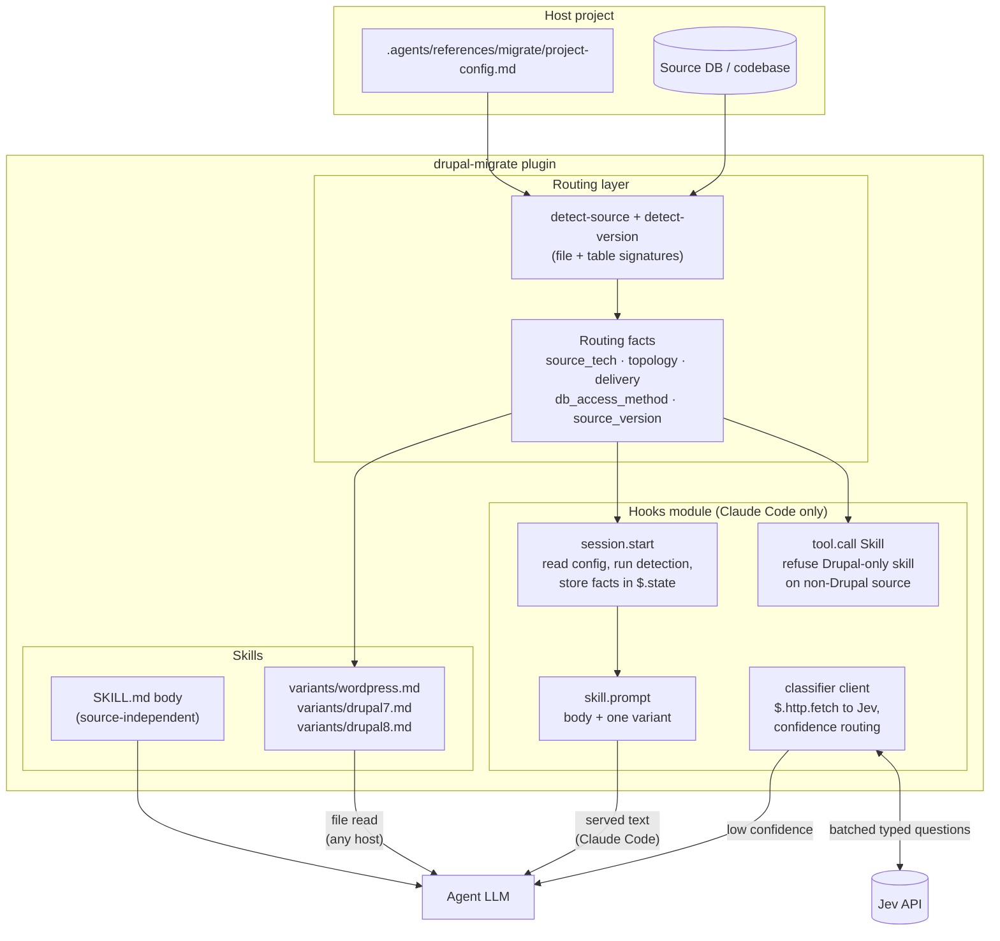
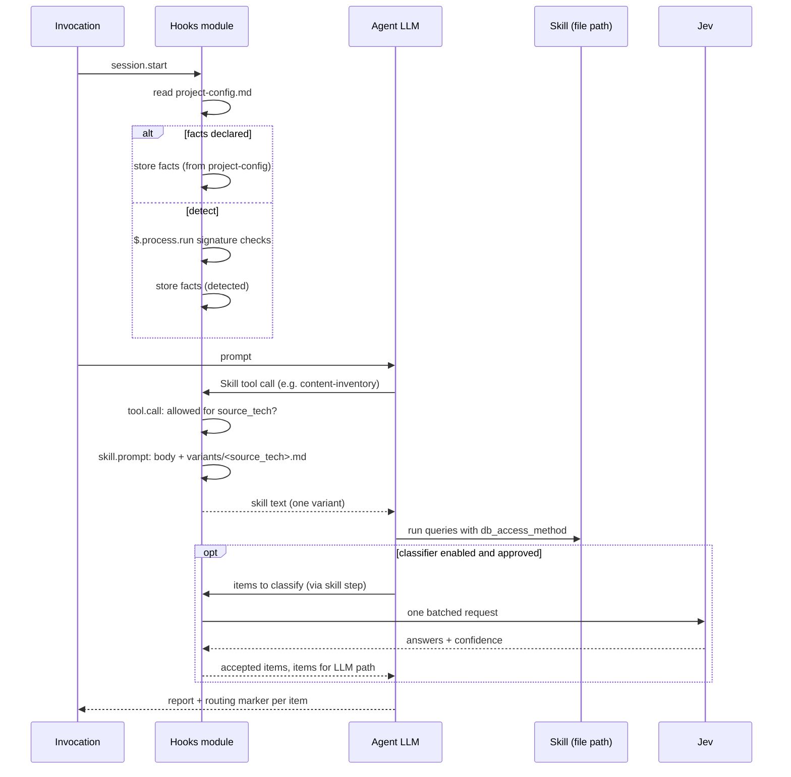
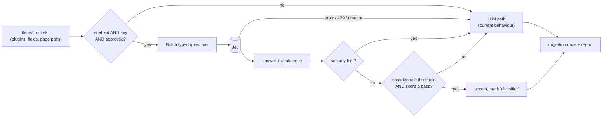

# Design

## Context

See `proposal.md` for motivation and
`plugins/drupal-migrate/docs/jev-classifier-routing-analysis.md` for the per-decision
analysis this design implements.

Current state that shapes the approach:

- The plugin is prose only: one agent file, 21 `SKILL.md` files, two reference
  templates. No hooks module, no scripts. Skills read project values from
  `.agents/references/migrate/project-config.md` in the host project.
- `drupal-migrate-detect-source` already returns the routing enum
  (`source_tech`, `topology`, `delivery`, `db_access_method`) and
  `drupal-migrate-detect-version` returns `source_version`. The enum is reported in
  prose and re-read by every later skill.
- 7 skills carry a "Drupal 7 differences" block; 4 skills carry WordPress and Drupal
  blocks side by side. `drupal-migrate-verify-content` is the largest skill (about
  3,300 words) and the highest-volume runtime step.
- The plugin is installed with `/plugin install` in Claude Code, but its skill files
  are also readable by other hosts. Claude Code mods (hooks modules) run only in the
  Claude Code CLI and desktop app; the mod API is early access and changes between
  releases (checked against build 2.1.296: `skill.prompt`, `tool.call`,
  `session.start`, `$.process.run`, `$.http.fetch`, `$.state`).
- Jev is reachable at `POST https://api.typesafe.ai/v1/systemone` with a bearer key,
  takes a `state` and a map of typed questions, and returns per-question
  `choice`/`score`/`noul` with `probabilities` and `confidence`. Limits: 255 options
  per choice, 2 to 10 score levels, context length not published. Documented rough
  edges: literal reading, first-option bias, lower non-English accuracy, state not
  treated as hostile.

## Goals / Non-Goals

**Goals:**

- One place that establishes routing facts; every skill consumes, none re-detects.
- A skill loads one variant. The loaded text for a given source is identical whether
  the variant is read from a file or served by the mod.
- The classifier path is additive: disabled, the plugin behaves as today; enabled, it
  only removes work from the LLM path and never changes what is written to the
  migration documents except through the LLM path or an accepted high-confidence
  answer.
- Everything the classifier decides is visible and measurable in the skill report.

**Non-Goals:**

- Replacing the agent LLM for phase/intent inference, module-to-contrib mapping, or
  any decision that needs ecosystem knowledge or the doc corpus.
- Running Jev locally, caching its answers across runs, or fine-tuning it.
- Supporting the mod in Copilot or OpenCode profiles.
- Changing the content or structure of the as-is / to-be document corpus.

## Architecture



### Run flow



### Confidence routing



## Decisions

### D1. Variant files are the primary mechanism; the mod is an optimisation

Each source-dependent skill becomes `SKILL.md` (body, prerequisites, steps with
placeholders) plus `variants/<source>.md` holding the tables and queries for one
source. The body says: "Load `variants/{source_tech}.md` (or
`variants/drupal7.md` when `source_version` is `drupal7`) before Step 1." In Claude
Code the mod's `skill.prompt` hook appends the variant to the body so the model never
issues the read; elsewhere the model reads the file.

Why: the plugin's skills must keep working in any host that reads skill files. A
mod-only mechanism would make the WordPress path depend on an early-access API.
Alternative considered: one `SKILL.md` per source per skill (`count-instances-d7`),
rejected because it triples the skill catalog and breaks the agent's skill table.

### D2. Routing facts live in one record, written once

The facts record is the output block `detect-source` already prints, made canonical:
in Claude Code it is stored in `$.state` by the mod at `session.start` (and refreshed
when `detect-source` runs); in other hosts the agent writes it into the roadmap block
and skills read it from there. `project-config.md` values win over detection; a
detected value is marked "detected" with its evidence.

Why: the agent prompt today repeats "pass `source_version: drupal7` to every step".
One record removes the repetition and the chance of a skill defaulting to D8+.
Alternative: have each skill re-run the cheap signature check, rejected because it
costs a tool call per skill and still leaves the branch text loaded.

### D3. Entity type by DB lookup, not name heuristic

Drupal 8+: `SELECT name FROM config WHERE name LIKE 'field.field.%.{bundle}.%'` gives
`field.field.<entity_type>.<bundle>.<field>`; the entity type is the second segment.
Drupal 7: `SELECT DISTINCT entity_type FROM field_config_instance WHERE bundle =
'{bundle}'`. `project-config.md` may declare a mapping that wins. Zero rows means the
bundle does not exist; more than one distinct entity type means ask.

Why: the heuristic ("name contains group/modal/card → paragraph") is wrong whenever
a project names bundles differently, which the skill itself admits. The lookup is one
query against tables every Drupal source has.

### D4. Classifier client lives in the mod, with a Bash fallback

In Claude Code the mod exposes the classifier through a skill step that the agent
runs as a tool call; the mod intercepts it, calls `$.http.fetch`, and returns only the
routing result (accepted items, items for the LLM). Outside Claude Code the same step
runs a `curl` command from a bundled script with the same request shape, and the
answer lands in the model context.

Why: a mod call keeps page bodies and plugin source out of the model context, which
is where the token saving is. The Bash fallback keeps behaviour identical in other
hosts at a higher token cost. Alternative: Python SDK, rejected because the plugin
would gain a runtime dependency on every workstation; `curl` is already required by
the repo's sync scripts.

### D5. Thresholds and gates are per-decision config in `project-config.md`

New optional section:

```markdown
## Classifier (optional)

| Setting                  | Value                                  |
| ------------------------ | -------------------------------------- |
| Enabled                  | `yes` / `no`                           |
| Provider                 | `typesafe-jev`                         |
| Model id                 | `jev-1.13` (pin it)                    |
| API key variable         | `TYPESAFE_API_KEY`                     |
| data_processing_approved | `yes` / `no` (reference to the DPA)    |
| Threshold codebase-scan  | `0.85`                                 |
| Threshold field-mapping  | `0.80`                                 |
| Threshold verify-content | confidence `0.80`, pass score `4` of 5 |
| measure                  | `yes` / `no` (run both paths, compare) |
```

Why: TypeSafe's own guidance is that thresholds depend on the domain and must be
tuned on your data; a missing threshold routes everything to the LLM, so an
under-configured project loses nothing. `data_processing_approved` is a hard gate
because the state is client content.

### D6. Question design follows Jev's documented rough edges

- Choice options are listed with descriptions and always end with `other` or `none`.
- The first option is never the "default" answer; option order is randomised per
  request in the client, and a measurement run checks answer stability under reorder.
- No counting, dates or arithmetic go to Jev; those stay in SQL and code.
- Page bodies are stripped of navigation, header, footer and script before they become
  state (`verify-content` already extracts main content for its comparison).
- Instructions and criteria are literal and name the state fields they refer to.

### D7. Measurement before trust

The `measure` flag runs both paths on every item and writes a per-item agreement table
to the report. The pilot runs on one completed migration with Italian content and one
with English content before any threshold is recommended as a default in the
template.

## Risks / Trade-offs

- [Mod API changes between Claude Code releases] → the mod is optional; the file-based
  path is the contract. Pin the checked build in the plugin README; add a
  `claude plugin validate` step to the plugin's CI job.
- [Client content sent to a second processor] → hard gate on
  `data_processing_approved`; the gate is a spec requirement, not a convention; the
  report always states when content was sent.
- [Lower accuracy on Italian content] → non-English note in every report; measurement
  run required before a threshold is set; `verify-content` low scores always reach
  the LLM, so a false "not faithful" costs tokens, not correctness. A false
  "faithful" is the real risk; the pilot measures it against the LLM path.
- [First-option bias and literal reading] → D6 mitigations; measurement checks
  reorder stability.
- [Variant split changes 11 skills at once] → one skill first
  (`drupal-migrate-count-instances`), its evals extended for D7 and WordPress refusal,
  then the pattern applied to the rest.
- [Token saving smaller than expected when many items fall below threshold] → the
  report counts accepted vs routed items; if the accepted fraction stays under about
  half on the pilot, the classifier is not worth enabling for that decision and the
  template says so.
- [Jev early access, waitlist] → the integration is dormant until a key exists;
  nothing in the plugin requires it.

## Migration Plan

1. Land the variant split and routing facts (spec `migrate-source-routing`) as a
   plugin version bump; existing projects need no config change because the facts
   already come from `project-config.md` or detection.
2. Land the mod in the same plugin version, disabled by nothing: it only serves what
   the files already contain. Users on hosts without mods see no difference.
3. Land the classifier capability dormant (no `Classifier` section means off). Enable
   it per project after the DPA is recorded and a measurement run has been reviewed.
4. Rollback: remove the `Classifier` section from `project-config.md` (classifier off)
   or disable the plugin's mod in `/plugin` (file-based variants remain).

## Open Questions

- Which past migration serves as the Italian measurement set, and who approves
  sending its content to TypeSafe for the pilot. This changes neither the specs nor
  the tasks; it decides when task group 6 can run.
- Whether `$.http.fetch` is allowed by the organisation's web-fetch policy on managed
  workstations. If not, the Bash `curl` fallback is used in Claude Code too.
