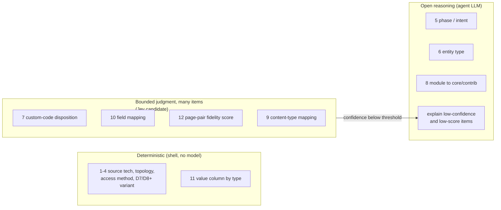

# Jev as a classifier inside the drupal-migrate plugin

Status: analysis, no decision taken. Date: 2026-10-13.

This document weighs using [Jev](https://typesafe.ai/blog/introducing-system-one-models-and-jev),
TypeSafe's "System One" classifier model, at the points where the `drupal-migrate`
plugin currently asks the coding-agent LLM to pick a skill, a query variant, or a
category. The two goals set for the improvement are lower token consumption and better
result quality.

## What Jev is, in the terms that matter here

- One HTTP call (`POST https://api.typesafe.ai/v1/systemone`, bearer key in
  `TYPESAFE_API_KEY`) takes a `state` (text or JSON) and a map of typed questions, and
  returns one answer per question. Question types: `choice` (one of up to 255 options),
  `score` (2 to 10 ordered levels), `noul` (probability of yes).
- Every `choice` and `score` answer carries a probability distribution and a
  `confidence` value in 0..1. The docs recommend acting automatically above a
  threshold and falling back to "a different system" below it.
- Latency 70 to 500 ms per call; input priced at $0.042 per million tokens, output
  free. All questions in one request are evaluated in parallel.
- It does not generate text. It cannot replace the agent LLM; it can only sit beside
  it. From a skill it is reachable through a Bash tool call (curl, or the Python/JS
  SDK), so each use costs one tool round-trip whose result lands back in the LLM
  context. From a Claude Code mod it is reachable through `$.http.fetch`, outside the
  LLM context (see "What Claude Code mods add").
- Documented rough edges in `jev-1.13`: literal reading of instructions, weak counting
  and arithmetic, reads dates as text, bias toward the first option, accuracy drops as
  irrelevant state grows, state is not treated as hostile, lower accuracy on
  non-English text, bounded context window (limit not published).
- Status on 2026-10-13: early access behind a waitlist. No self-hosting, model size not
  disclosed, no published calibration data. The vendor's own evals use two frontier
  LLMs as reference labels and report no sample sizes.

## Where the plugin classifies today

Every decision below is taken by the agent LLM reading prose in
`agents/drupal-migration-analyst.agent.md` or in a `SKILL.md`. The table also records
what the input actually is, because that decides whether a classifier helps at all.

| #   | Decision                                             | Where                                                            | Options                                                                    | Input nature                                              |
| --- | ---------------------------------------------------- | ---------------------------------------------------------------- | -------------------------------------------------------------------------- | --------------------------------------------------------- |
| 1   | Source technology                                    | `detect-source` step 2                                           | wordpress / drupal7 / drupal8+ / other                                     | Deterministic: file names and table signatures            |
| 2   | Topology, delivery, DB access method                 | `detect-source` steps 3 to 4                                     | 2 / 3 / 4 options                                                          | Deterministic: table presence, config values              |
| 3   | Drupal 7 vs 8+ query variant                         | 7 skills with a "Drupal 7 differences" block                     | 2                                                                          | Deterministic: output of `detect-version`                 |
| 4   | WordPress vs Drupal query variant                    | `content-inventory`, `ia-audit`, `platform-audit`, `db-discover` | 2                                                                          | Deterministic: output of `detect-source`                  |
| 5   | Phase / intent of the invocation                     | Agent, "Phase-driven workflows"                                  | 7 (phase 0, as-is, bundle analysis, mapping, tech analysis, issue, verify) | Fuzzy: free-text prompt plus corpus state                 |
| 6   | Entity type of a bundle                              | Agent, "Entity-type inference"                                   | node / paragraph / taxonomy_term / ambiguous                               | Fuzzy heuristic on the name, but a DB lookup is available |
| 7   | Custom-code disposition, one per plugin/module/theme | `codebase-scan`                                                  | replicate / triage / do-not-port / security                                | Fuzzy: code, headers, readme; N items per run             |
| 8   | Source module or plugin disposition                  | `mapping-triage`                                                 | core / contrib / custom module / drop                                      | Fuzzy, needs ecosystem knowledge; N items                 |
| 9   | Source content type to target content type           | `mapping-triage`                                                 | direct reuse / many-to-one / no source / no target, plus which target      | Fuzzy; N source types against M targets                   |
| 10  | Source field to destination field                    | `scan-destination`                                               | one destination field or none                                              | Fuzzy; N fields against M candidates                      |
| 11  | Value column by field type                           | `field-population`                                               | `_value`, `_target_id`, `_uri`, ...                                        | Deterministic lookup table                                |
| 12  | "Was this page migrated faithfully?"                 | `verify-content`                                                 | Judgment per page pair, plus redirect and translation checks               | Fuzzy; two page bodies per item; N pages per run          |

Rows 1 to 4 and 11 are not classification problems. The evidence is already an enum
produced by a shell command. Rows 5 to 10 and 12 are real judgments.

## Where the tokens actually go

Measured on the current plugin tree (`wc`): the agent prompt is about 4,000 words and
the 21 skills total about 20,500 words, roughly 190 KB. A run loads the agent plus each
invoked skill, so a full as-is run on a Drupal source reads on the order of 40k to 60k
tokens of instructions before any data. Every skill that supports two sources carries
both branches; the LLM reads the WordPress block and the Drupal block and uses one.

Jev does not touch that cost. The instruction text is loaded by Claude Code when the
skill is invoked, whatever decides the invocation. To stop paying for the unused
branch the plugin must serve one variant: either split the skills (or their query
blocks) per source variant, or let a mod's `skill.prompt` hook strip the branches that
do not apply before the model reads the skill. Both are routed by the enum that
`detect-source` already emits, and neither needs a classifier model.

Where Jev can reduce tokens is the per-item work in rows 7, 9, 10 and 12, where today
the LLM reads N inputs, reasons about each, and writes a verdict. Rough order of
magnitude for `verify-content` on a 200-page migration: two page bodies of 2k to 4k
tokens each plus the LLM's reasoning, so 1 to 2 million input tokens and a few hundred
thousand output tokens through the agent model. The same page pairs through Jev cost
about $0.05 to $0.10 of input and return a score per page in under a second each. The
LLM is then called only for the pages Jev scores low or with low confidence, to
explain what differs. The same shape applies to `codebase-scan` on a site with 50
plugins and to field mapping with 40 fields against 60 destination fields.

## Advantages

- **Calibrated confidence is new capability.** The LLM returns a verdict with no
  usable probability. Jev's `confidence` lets the plugin route low-confidence items to
  the LLM or to the "open questions" list automatically, which is what
  `mapping-triage` and `codebase-scan` already try to do in prose.
- **Batching.** One request can carry one `choice` per custom plugin, or one `score`
  per page pair, evaluated in parallel. Today each item is a few hundred tokens of
  reasoning and output.
- **Consistency.** The same state and criteria give the same answer, whereas an LLM
  reading a 1,000-word skill may apply the disposition rules differently across runs.
- **Cost on volume.** $0.042 per million input tokens against $5 to $25 per million on
  the agent models used for migrations. The saving is only real where N is large.
- **It fits the plugin's own design.** The skills already define closed enums
  (dispositions, mapping categories) and already say "mark low-confidence items as open
  questions". Jev turns that prose into a measured threshold.

## Disadvantages and risks

- **Client data leaves the workstation to a second processor.** Page bodies, plugin
  source, field names and sample values are the state. Today only the sanctioned
  agent provider sees them. Sending them to TypeSafe needs a data-processing agreement
  and, for client migrations, the client's approval. This is a blocker, not a detail.
- **Non-English accuracy is documented as lower.** Most SparkFabrik migrations carry
  Italian content. `verify-content` on Italian page pairs is exactly the high-volume
  case, and it is the one most exposed to this limit. It must be measured before any
  rollout.
- **Early access and vendor lock-in.** Waitlist access, no self-hosting, undisclosed
  model size, no public calibration data, evals labeled by LLMs with no sample sizes.
  A plugin distributed to every team member cannot depend on a model nobody can run
  locally yet.
- **Operational surface.** Every workstation needs `TYPESAFE_API_KEY`, curl 7.76+ or
  the SDK, network egress, and a skill fallback when the key is missing. The plugin
  today needs only the project's existing DB runner.
- **Jev is literal and cannot reason across hops.** Rows 5, 6 and 8 need context the
  state does not contain (the corpus state, the Drupal contrib ecosystem, what a
  bundle name implies in this project). Jev picks among the options it is given; it
  cannot discover a contrib module or read `decisions.md`.
- **Adversarial content.** Source sites are untrusted. A WordPress page or plugin
  readme can shift a Jev answer, and the docs say state is not treated as hostile.
  Dispositions such as `security` must never rest on Jev alone.
- **No explanation.** A score of 2/5 on a page says nothing about what is missing.
  The LLM pass is still needed on every flagged item, so the token saving depends on
  the flagged fraction staying small.
- **From a skill, each call is a tool round-trip.** For a single decision (one
  invocation, one bundle) the round-trip costs more tokens than the decision it
  replaces. A mod removes the round-trip but adds the dependency on the mod API below.

## What Claude Code mods add

Claude Code mods ([announcement, 2026-10-01](https://claude.com/resources/articles/claude-code-mods))
are TypeScript hooks that ship inside a plugin and run before, after, or in place of
engine events, outside the model's context. The `drupal-migrate` plugin has no hooks
module today. Checked against the mod API declarations of build 2.1.296, these pieces
matter for routing:

| Mechanism                                | What it gives the plugin                                                                                                                                        |
| ---------------------------------------- | --------------------------------------------------------------------------------------------------------------------------------------------------------------- |
| `skill.prompt` hook                      | Rewrites the text the model reads when a skill expands. The plugin can serve only the WordPress or only the Drupal 7 block of a `SKILL.md`, with no file split. |
| `tool.call` hook on `Skill`              | Can deny or redirect a skill invocation, so the agent cannot run a Drupal-only bundle skill against a WordPress source.                                         |
| `$.process.run`                          | Runs the detection commands (file signatures, `SELECT 1`, table signatures) on the host and keeps the result in `$.state`, with no tokens spent on the output.  |
| `$.http.fetch`                           | Calls an HTTP API, Jev included, with no tool round-trip through the model. Subject to the organization's web-fetch policy.                                     |
| `$.model.classify(text, labels)`         | A built-in classifier: one Haiku completion, returns one label or `undefined`. First-party, so no second data processor. No probabilities or confidence.        |
| `prompt.compose` / `prompt.submit` hooks | Inject the routing facts (source tech, access method, D7/D8+) into the system prompt or the invocation once, instead of restating them in every skill.          |

Consequences for the analysis:

- Rows 1 to 4 become fully deterministic and token-free: a `session.start` or
  `prompt.submit` hook reads `project-config.md` or runs the signature checks, stores
  the enum, and `skill.prompt` serves the matching variant. This is the cleanest route
  to the "correct query for WordPress" goal and needs neither Jev nor the LLM.
- Row 5 (phase/intent) gains a cheap first-party option: `$.model.classify` over the
  invocation text with the seven phase labels, falling back to the LLM when it returns
  `undefined`. Client content does not leave the sanctioned provider.
- Rows 7, 10 and 12 can call Jev from a mod with batched questions and act on
  `confidence` in code, which is the intent-routing pattern TypeSafe documents. The
  data-processing and language blockers stay exactly as they are; only the round-trip
  cost goes away.
- Jev's `confidence` is the one thing `$.model.classify` lacks. If the plugin needs
  threshold routing, Jev (or an LLM asked for a probability, which is uncalibrated)
  remains the only source of it.

Caveats specific to mods: the API is early access and "moves between releases"; mods
are not sandboxed; on Team and Enterprise plans the `sec-default` mod loads first and
admins can block marketplaces; mods run in the CLI and desktop app only, not in the
`sjust`-synced Copilot or OpenCode profiles, so a mod-based routing layer helps only
Claude Code users of the plugin.

## Assessment per decision point

| #    | Verdict                                           | Reason                                                                                                                                                           |
| ---- | ------------------------------------------------- | ---------------------------------------------------------------------------------------------------------------------------------------------------------------- |
| 1-4  | Deterministic, no Jev                             | Already an enum from shell evidence. Serve one variant per source, by file split or by a `skill.prompt` mod; that is the token win the request asks for.         |
| 5    | Keep in the LLM, or `$.model.classify` in a mod   | Seven options, one decision per run, needs corpus state. A Jev call from a skill would cost more than it saves; a first-party classify in a mod is free of that. |
| 6    | Replace with a DB lookup                          | `config` / `field_config_instance` names the entity type of any bundle. Neither heuristic nor Jev is needed.                                                     |
| 7    | Jev pilot candidate                               | Many items, closed enum, confidence routing wanted. Exclude `security` from automatic assignment.                                                                |
| 8    | Keep in the LLM                                   | Needs ecosystem knowledge and web research (`drupal-solution-research`). Jev could rank candidates the LLM finds, which is a second step.                        |
| 9-10 | Jev pilot candidate                               | Choice over destination types or fields with descriptions, plus a `none` option. Bounded, repetitive, confidence useful.                                         |
| 11   | Deterministic, no Jev                             | Lookup table.                                                                                                                                                    |
| 12   | Strongest candidate, blocked by data and language | Highest volume, highest token spend, score plus confidence fits. Needs boilerplate stripping, Italian accuracy data, and a processing agreement.                 |

## Recommendation

1. Do the deterministic routing first, without Jev. Serve only the query variant
   `detect-source` and `detect-version` selected (rows 3 and 4), and replace the
   entity-type name heuristic (row 6) with the DB lookup. Two ways to serve the
   variant: split the query blocks into per-source files the skill `cat`s, which works
   in every host; or a mod with `skill.prompt` that strips the unused blocks, which
   works in Claude Code only but needs no file restructuring. Start with the file
   split, since the plugin's skills are also read by non-Claude hosts; add the mod
   later as an optimisation. This delivers the "use the right query for WordPress"
   improvement and most of the instruction-token saving with no new vendor.
2. Pilot Jev on rows 7, 10 and 12 only, called from a mod via `$.http.fetch` with
   batched questions and confidence routing in code, behind an optional flag in
   `project-config.md`, with the LLM path as the default when the key is absent.
   Measure on one past migration: agreement with the recorded human decisions, the
   fraction routed to the LLM at the chosen threshold, Italian versus English
   accuracy, and total tokens per run against the current path.
3. Treat these as gates before any distribution: a processing agreement that covers
   client content, access out of the waitlist, and a measured Italian accuracy on
   `verify-content` that is not worse than the current LLM pass.

If the gates are not met, item 1 still stands on its own and should ship.

## References

- Claude Code mods announcement: <https://claude.com/resources/articles/claude-code-mods>
- Mod API used above: `skill.prompt`, `tool.call`, `$.process.run`, `$.http.fetch`,
  `$.model.classify`, from the `claude-code` type declarations of build 2.1.296
  (the `plugin-authoring` skill writes them on load; early access, may change)
- TypeSafe announcement: <https://typesafe.ai/blog/introducing-system-one-models-and-jev>
- API reference: <https://docs.typesafe.ai/api>
- Intent-routing pattern: <https://docs.typesafe.ai/patterns/intent-routing>
- Skill-suggestion cookbook (182-skill catalog, confidence gating):
  <https://docs.typesafe.ai/cookbooks/skill_suggestion>
- Known rough edges in jev-1.13: <https://docs.typesafe.ai/model-jaggedness/jev-1.13>
- Vendor evals and caveats: <https://evals.typesafe.ai>
- Claude Code plugin for experiments: `claude plugin marketplace add typesafe-ai/skills`
  then `claude plugin install typesafe@typesafe-ai`
